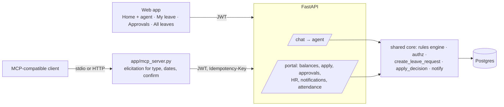

# People Lens: Architecture

See also [DESIGN_NOTE.md](DESIGN_NOTE.md) for the reasoning behind each choice and [DATA_MODEL.md](DATA_MODEL.md) for the schema and models.

## Tech stack

| Layer | Choice | Why / alternatives |
|---|---|---|
| Language | Python 3.12+ (tested on 3.13) | Best ecosystem for LLM, RAG, ML and eval work |
| API | FastAPI + Pydantic v2 | Typed contracts, interactive docs at `/docs` |
| Orchestration | LangGraph `StateGraph` | Explicit, testable nodes (guard → confirm → route → agent ⇄ verify → finalize). Alt: a plain loop (less structure), CrewAI (less control) |
| LLM | **OpenAI or xAI Grok**, chosen by `LLM_PROVIDER`, through the `openai` SDK | `OPENAI_PRIMARY_MODEL` / `GROK_PRIMARY_MODEL` for tool use and reasoning; the matching `*_FAST_MODEL` for routing and text-to-SQL. The other provider is unused. |
| Embeddings | `BAAI/bge-small-en-v1.5` (fastembed, local ONNX) | No key, deterministic, 384-dim. Alt: hosted embeddings (better recall, external dependency) |
| Reranker | `ms-marco-MiniLM-L-6-v2` cross-encoder (local) | Precision at the top, and its score drives abstention |
| DB + vectors | PostgreSQL 16 + pgvector (HNSW) + `tsvector` | One store for HR data, the knowledge base, memory, actions and telemetry. Transactions make actions idempotent; views and a read-only role enforce scope inside the database |
| SQL safety | sqlglot AST validation | Allows a single SELECT over allow-listed scoped views only |
| Analytics | numpy (robust z-score, backtested forecast) | Statistics compute the results; the LLM only explains them |
| UI | Static web app (vanilla HTML/CSS/JS, no build step) served by `ui/serve.py` | Sidebar navigation, a top bar with Ask AI, notifications and check-in, the agent card (suggestions, pending, actions, insights), and the leave, approvals and HR pages. It calls the API directly over CORS. Markdown is escaped before rendering |
| Observability | JSON logs + `ops.traces` / `ops.tool_calls` / `ops.audit_log` | trace id, tools, chunks, authz decisions, latency, tokens, cost, retries, all with PII redacted |
| Tests / eval | pytest (118 tests, fake LLM) + golden set (42 cases, real LLM) | |

## System diagram

```mermaid
flowchart TB
  UI[Web app<br/>people picker · agent card · dashboards · confirm/cancel] -->|JWT| API
  subgraph API[FastAPI]
    AUTH[auth: JWT carries user id only;<br/>role re-read from DB every request]
    SESS[session ownership check]
    ACT[/POST /actions/:id/confirm · cancel/]
  end
  API --> ORCH
  subgraph ORCH[LangGraph turn]
    G[guard<br/>rule-based, no LLM] -->|blocked| F
    G --> PA[pending_action<br/>'yes'/'no' handled in code]
    PA -->|executed/cancelled| F
    PA --> R[router · fast model<br/>heuristic fallback]
    R -->|unsupported / clarify| F
    R --> A[agent · primary model<br/>role-filtered tools, ≤8 steps]
    A --> V[verify<br/>numbers ⊆ tool data · citations ⊆ retrieved ·<br/>no false 'submitted' claims]
    V -->|fail once: regenerate| A
    V --> F[finalize → AgentResponse]
    A -->|LLM down| D[degraded: cited policy excerpts]
  end
  A --> EXE
  subgraph EXE[Tool executor]
    L1[1 role gate] --> L2[2 Pydantic arg validation] --> L3[3 scope check in tool<br/>self / reporting tree / org]
  end
  EXE --> T1[search_policy → hybrid RAG]
  EXE --> T2[profile · balances · requests · team ·<br/>eligibility rules engine]
  EXE --> T3[workforce_stats · run_sql_analytics<br/>scoped views as pl_readonly]
  EXE --> T4[detect_anomalies · forecast_availability]
  EXE --> T5[propose_leave · propose_decision<br/>→ agent.pending_actions]
  ACT --> X[confirm_action: row lock, re-validate,<br/>idempotency key, read-back]
  PA --> X
  subgraph PG[(PostgreSQL + pgvector)]
    HR[hr.*: employees, leave, attendance…<br/>EXCLUDE no-overlap · balance CHECK]
    KB[kb.*: documents → versions → chunks]
    AG[agent.*: sessions, messages, session_state, pending_actions]
    OPS[ops.*: traces, tool_calls, audit_log, eval_*]
  end
  T1 --> KB
  T2 & T3 & T4 & X --> HR
  T5 --> AG
  ING[ingest: front matter → section chunks →<br/>injection sanitiser → embed → version upsert] --> KB
```

## Request lifecycle (example: "Apply for casual leave next Monday and Tuesday")

1. **guard**: no injection pattern, so it passes.
2. **pending_action**: not a yes/no reply, so it is skipped.
3. **router** (fast model): `intents=[action]`.
4. **agent** (primary model): sees only the tools for the employee role. It calls `resolve_dates("next Monday and Tuesday")`
   and gets 2026-11-30 to 2026-12-01 (deterministic). Then it calls `propose_leave(CL, …)`. The rules engine checks
   balance, notice, the consecutive-day limit, probation, overlaps and the approver, and stores a `pending_actions` row.
   The model summarises the proposal.
5. **verify**: every number in the answer is found in tool output, and no "submitted" claim is made.
6. The UI shows Confirm and Cancel. **Confirm** (button or "yes") runs `confirm_action`: it locks the row, re-validates,
   inserts with a unique idempotency key, reserves the balance, writes approval history, and returns the **real**
   `LR-2026-xxxxxx` id and status read back from the database. A repeated confirm returns `already_executed` with the same id.

## Security controls (none rely on the prompt)

| Threat | Control |
|---|---|
| Prompt injection / jailbreak | Rule-based input guard blocks before any LLM call; audited |
| Role spoofing ("pretend I am HR") | Role comes from `hr.app_users` per request; JWT holds only the user id |
| Unauthorized data access | Role-filtered tool list, a role gate in the executor, and scope checks in each tool (`resolve_employee` gives the same denial for "doesn't exist" and "not yours") |
| Cross-user leakage | Session ownership check on every call; memory holds pointers only and is re-authorized through tools |
| Text-to-SQL abuse | sqlglot allow-list, then `SET LOCAL ROLE pl_readonly` (SELECT on scoped views only), a read-only transaction and a 3 s timeout |
| Unauthorized actions | `propose_decision` and execution both check approver == caller and requester ≠ caller, re-checked under a row lock |
| Duplicate actions | Proposal fingerprint reuse, `FOR UPDATE` on the action row, `UNIQUE(idempotency_key)`, and an `EXCLUDE` constraint on overlapping leave |
| Hallucinated numbers / policies | Grounding check with one regeneration; persistent issues are flagged to the user (confidence `partial`); abstention below the rerank threshold |
| False success claims | The LLM cannot execute actions. Success text comes only from the executor's committed result; claims are regex-checked |
| Malicious text in documents | Sanitised and flagged at ingest; wrapped as reference data at retrieval |
| Secrets / PII in logs | Redaction of emails and keys in logs and traces; arguments stored redacted |

## Channels: web app, chat agent, MCP



Leave requests are created and decided only in `create_leave_request` / `apply_decision` (`app/tools/actions.py`),
whatever the channel: chat confirmation, dashboard button or MCP. Eligibility, approver routing, the no-self-approval
rule, idempotency, balance reservation, approval history and notifications are therefore identical everywhere.
Notifications go to the approver on submission and to the employee on decision, in the same transaction as the change.
